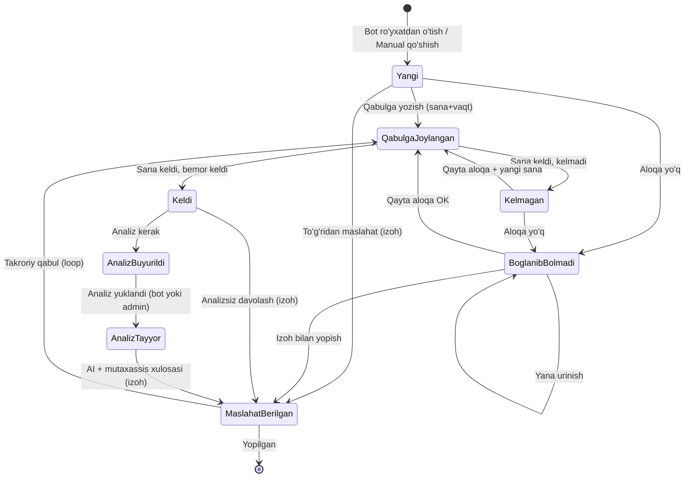

# RegUrolog — Reja (Urolog Sardor CRM + Telegram Bot)

Bemor va leadlarni avtomatik ushlaydigan tizim. Telegram bot orqali lead yig'iladi, admin panelda boshqariladi.

---

## 1. Arxitektura

```
reg-urology/
├── frontend/   React 19 + Vite + TS + Tailwind v4 + Untitled UI   (admin panel + Telegram WebApp)
└── backend/    FastAPI + aiogram + SQLAlchemy + Alembic + PostgreSQL
```

- **Deploy:** Railway. Har bir root papka uchun alohida `Dockerfile`.
- **Bot:** aiogram (long-polling dev / webhook prod). Bir bot ham bemor, ham xodim uchun (rolga qarab menyu farqlanadi).
- **Realtime:** admin panelga status yangilanishi uchun WebSocket yoki SSE (dashboard va bemorlar ro'yxati jonli yangilanadi).
- **Fayllar:** analiz rasmlari/PDF — object storage (Railway volume yoki S3-mos) + DB'da metadata.
- **AI:** sozlamalarda ulanadigan token (Claude API) orqali analiz tahlili.

---

## 2. Rollar va accesslar

| Rol | Kirish | Ko'radi | Qila oladi |
|---|---|---|---|
| **Dev** | ENV login/parol | Hammasi + Faoliyat logi | Hammasi, tizim sozlamalari |
| **Director** | Telegram (token→session) | Hammasi + Faoliyat logi | Hammasi (dev sozlamalaridan tashqari) |
| **Admin** | Telegram (token→session) | Bemorlar [Yangi\|Jarayonda\|Javobsiz], Kalendar | Status boshqarish, qabulga yozish, analiz yuklash |
| **Analizchi mutaxassis** | Telegram (token→session) | Faqat **Jarayondagi** bemorlar | Analiz yuklash (barcha statuslar uchun), **statusni o'zgartira olmaydi** |

Dashboard 4 rol uchun access turiga qarab farqlanadi.

---

## 3. Ma'lumotlar modeli (asosiy jadvallar)

- **staff** — `id, role, telegram_user_id, full_name, login?, phone, is_active, created_at`
- **staff_session** — token orqali onboarding: `token, staff_id?, status(pending/confirmed), qr, expires_at`
- **patient** — `id, full_name, phone, telegram_user_id?, telegram_username?, consultation_goal?, source(bot/manual), invite_token?, status, assigned_staff_id?, created_at`
- **status_history** — `id, patient_id, from_status, to_status, staff_id, note?, at` (stepper uchun)
- **appointment** — `id, patient_id, staff_id, start_at, duration_min, status, room?`
- **analysis** — `id, patient_id, uploaded_by(patient/staff), telegram_file_id, telegram_file_unique_id, file_name?, mime_type?, ordered(bool), ai_report?, created_at`
- **settings** — `bot_token, ai_token, work_hours(start/end), slot_minutes, bot_texts(jsonb), clinic{name, coords, contacts}`
- **activity_log** — `id, staff_id, action, entity, meta, at` (dev/director faoliyat bo'limi)

---

## 4. Bemor statuslari (enum)

`Yangi` · `Qabulga joylangan` (sana+vaqt) · `Bog'lanib bo'lmadi` · `Maslahat berilgan` (izoh) · `Kelmagan` · `Keldi` · `Analiz buyurildi` · `Analiz tayyor`

---

## 5. Qabul algoritmi (loop)



**Qoidalar:**
- Har bir o'tish `status_history`ga yoziladi (stepper shu tarixdan chiziladi).
- Har o'zgarishda bemorga bot orqali xabar boradi — **shu jumladan "Bog'lanib bo'lmadi"da ham**.
- **Analiz yuklash** har qanday statusda mumkin (admin/analizchi paneldan). Bemorga esa faqat `Analiz buyurildi` bo'lsa "namunani topshiring/yuklang" xabari boradi.
- `Analiz buyurilmasdan` ham `Keldi → Maslahat berilgan` yo'li bor (analizsiz davolash).
- Admin analiz yuklaganda bemorga analiz namunasi fayli yuboriladi.

---

## 6. Telegram bot — Bemor oqimi

1. `/start` → ism-familiya (bitta string) so'raladi.
2. Telefon raqam (Telegram contact tugmasi yoki matn). **Raqam kelishi bilan → `patient(status=Yangi)`** yoziladi.
3. Ixtiyoriy: konsultatsiya maqsadi — inline tugma `[O'tkazib yuborish]` bilan.
4. Muvaffaqiyat xabari + doimiy menyu.

**Doimiy menyu (reply keyboard):** `Status` · `Hujjatlar` · `Klinika haqida`
- **Status:** `Yangi` → "mutaxassislarimiz tez orada bog'lanadi"; `Qabulga joylangan` → aniq sana/vaqt.
- **Analiz oqimi:** `Analiz buyurildi` bo'lsa bot → "Analiz buyurildi, namunani suratga oling / faylni yuklang" → bemor rasm/fayl yuboradi.
- Yuklangach: *"Analiz muvaffaqiyatli yuklandi, mutaxassis maslahatini olishni xohlaysizmi?"* → `[✨ Analizni tahlil qilish]` → AI report bemorga yuboriladi + admin panelga saqlanadi.

---

## 7. Telegram bot — Xodim oqimi (onboarding)

- Dev panelda **token** yaratadi → xodim botga token yuboradi yoki **QR** skaner qiladi → `staff_session(pending)` → tasdiqlanadi → `telegram_user_id` bog'lanadi.
- Xodim keyboard markup: `[Asosiy menyu (WebApp)]` · `[Bemor ro'yxatga o'tkazish]`.
- WebApp tugmasi admin panelni Telegram ichida ochadi (rolga qarab).

---

## 8. Admin panel — Tablar (mobile-first, desktopga responsive)

Untitled UI komponentlari bilan:

| Tab | Mazmun | Untitled UI |
|---|---|---|
| **Dashboard** | Statistik kartalar + grafiklar (rolga qarab 4 xil) | `charts`, metric cards |
| **Bemorlar** | Segment: `YANGI \| JARAYONDA \| JAVOBSIZ`. Ro'yxat + qidiruv + qatordagi tugmalar: TG profil, TG aloqa, Qo'ng'iroq, **Qabulga yozish +**, O'chirish. Qatorni bosib → slideout: **stepper** (status tarixi) + boshqaruv. **Manual qo'shish** (invite-link + SMS deeplink tavsiyasi). | `table`, `tabs`, `slideout-menus`, `modals`, `file-upload` |
| **Kalendar** | Kun/Hafta/Oy tablari. Ish vaqti + slot_minutes'ga qarab slotlar. Qabullar ko'rinadi, **drag-and-drop** boshqa kunga ko'chirish, bosib bemor profili. | `date-picker`, custom calendar grid |
| **Xodimlar** | Har xodim: qabul qilgan bemorlar statistikasi, login, profil. | `table`, charts |
| **Sozlamalar** | Bot token, ish vaqtlari, AI token, bot matnlari, klinika profili (nom, koordinatalar, kontaktlar). | forms, `modals` |
| **Faoliyat** *(Dev/Director)* | Har xodim ishlari, yangi leadlar logi. | `table` |

**Manual ro'yxat:** xodim bemor qo'shadi → bot uchun `invite_token` + deeplink yaratiladi → SMS funksiyasi yo'q, shuning uchun "raqamga yuborish" tugmasi (deeplink nusxalash). Bemor botni ochib `/start` bossa — ma'lumotlari bog'lanadi.

---

## 9. Analiz + AI oqimi

- Analiz fayllari: bot orqali (bemor) yoki admin/analizchi paneldan (klinikada yoki tashqarida topshirilsa ham).
- `[✨ Analizni tahlil qilish]` → AI (sozlamalardagi token) natijalarni normal ko'rsatkichlar bilan solishtiradi, maslahat beradi.
- Report: bemorga yuboriladi **va** admin panelga `analysis.ai_report`ga saqlanadi.

### Fayl saqlash strategiyasi (volume emas, Telegram file_id)

Volume doimiy saqlash uchun ishlatilmaydi — faqat qisqa muddatli oraliq bosqich sifatida. Doimiy manba — Telegram serverlari (`file_id` orqali).

- **Admin/analizchi paneldan yuklasa** (klinikada yoki boshqa joyda topshirilgan analiz, brauzerdan fayl yuklanadi): backend faylni **bot orqali bemorga yuboradi** (bu — spetsifikatsiyadagi "analiz namunasi fayli bemorga yuboriladi" qadamining o'zi) → shu yuborishdan qaytgan `file_id`/`file_unique_id` `analysis` jadvaliga yoziladi → vaqtinchalik faylga ehtiyoj qolmaydi.
- **Bemor bot orqali yuklasa** (rasm/fayl bot chatiga yuboradi): bemorning original xabari o'chirilishi mumkinligi sababli, bot faylni **vaqtincha volumega yozadi** → darhol shu faylni botning o'z nomidan ichki saqlash chatiga (bemorga ko'rinmaydigan, faqat bot boshqaradigan chat/kanal) qayta yuklaydi → yangi, botga tegishli `file_id` olinadi va DB'ga saqlanadi → vaqtinchalik fayl volumedan o'chiriladi. Natijada bemor o'z xabarini o'chirsa ham, botdagi nusxa saqlanib qoladi.
- **Access:** istalgan vaqtda `GET /analysis/{id}/file` — backend saqlangan `file_id` bo'yicha Telegramdan faylni oqim (stream) qilib beradi (proxy), doimiy nusxa serverda saqlanmaydi.

---

## 10. Notifikatsiyalar

Har status o'zgarishida bemorga avtomatik xabar (shu jumladan "Bog'lanib bo'lmadi"). Qabulga yozilganda sana/vaqt. Analiz buyurilganda topshirish so'rovi. Analiz yuklanganda tasdiq + AI taklifi.

---

## 11. API yuzasi (qisqa)

- **Auth:** `POST /auth/dev-login`, `POST /auth/staff/token`, `POST /auth/staff/confirm`, QR endpoint.
- **Patients:** `GET/POST /patients`, `GET /patients/{id}`, `PATCH /patients/{id}/status`, `DELETE /patients/{id}`, `GET /patients/{id}/history`.
- **Appointments:** `GET/POST /appointments`, `PATCH /appointments/{id}` (drag-drop ko'chirish), slot generatsiya.
- **Analysis:** `POST /patients/{id}/analysis` (staff yuklaydi → botga forward → file_id saqlanadi), `GET /analysis/{id}/file` (Telegramdan proxy-stream), `POST /analysis/{id}/ai-report`.
- **Staff:** `GET /staff`, `GET /staff/{id}/stats`.
- **Settings:** `GET/PUT /settings`.
- **Activity:** `GET /activity`.
- **Bot webhook:** `POST /bot/webhook`.

---

## 12. Bosqichli yo'l xaritasi

1. **Backend skeleti** — FastAPI, DB, Alembic, modellar, auth (dev + staff token/QR).
2. **Bot MVP** — bemor ro'yxati (ism, telefon, maqsad), doimiy menyu, status ko'rsatish.
3. **Admin panel** — Bemorlar (segmentlar, table, slideout stepper), manual qo'shish.
4. **Kalendar** — slotlar, qabulga yozish, drag-and-drop.
5. **Analiz + AI** — fayl yuklash (bot + panel), AI report.
6. **Dashboard + Xodimlar + Faoliyat** — rolga qarab, grafiklar.
7. **Sozlamalar** — bot token, ish vaqti, AI token, matnlar, klinika profili.
8. **Notifikatsiyalar** + realtime + Docker/Railway deploy.
